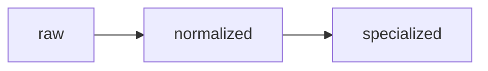
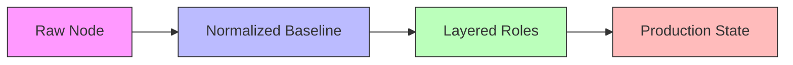

# uc-gradus

## Description

UC-Gradus is a layered convergence system that transforms raw nodes into
normalized baselines, then composes role-specific configurations on top.
The substrate is irrelevant — the convergence path for node states is:



So, an Incus container, a KVM virtual machine, and bare metal all follow the same sequence. Normalization is the invariant; specialization is the variable layer.

## Commands

```bash
gradus onboard
gradus normalize
gradus roles list
gradus roles apply 1,3,5
```

## Convergence Model



## Minimal Example

| Layer | Playbook | Nature | Purpose |
|-------|----------|--------|---------|
| 1 | `onboarding.yml` | One-time | Provision OOB user, install prerequisites, lock root SSH |
| 2 | `normalize.yml` | Idempotent | Harden baseline: SSH, firewall, updates, users, cron, NTP |
| 3 | `caddy-server.yml` | Idempotent | Compose serving role on top of normalized baseline |

Each layer assumes the previous layer has converged. Re-running a converged
layer produces zero changes unless drift has occurred.

## Prerequisites

- Ansible >= 2.16 on the control node
- Target: Debian 13 (minimal install or Incus image)
- SSH access to the target as the out-of-box user
- SSH keypairs generated (see below)
- Robertdebock roles installed:

```bash
ansible-galaxy install \
 robertdebock.bootstrap \
 robertdebock.epel \
 robertdebock.update \
 robertdebock.auto_update \
 robertdebock.cron \
 robertdebock.ntp \
 robertdebock.openssh \
 robertdebock.fail2ban \
 robertdebock.firewall \
 robertdebock.umask \
 robertdebock.users
```

## SSH Keypairs

Each environment gets two keypairs: one for human admin access, one for
automated deployment. Keys are never shared across environments.


## Naming Convention

```text
gradus-<environment>-<purpose>-<algorithm>
```

| Component | Values | Meaning |
|-----------|--------|---------|
| environment | `dev`, `stage`, `prod` | Which fleet the key reaches |
| purpose | `admin`, `deploy` | Human access vs automation |
| algorithm | `id_ed25519`, `id_rsa` | Key type (future-proof for provider constraints) |

## Keypair Inventory

```text
    ~/.ssh/
    # raw key pair example
    ├── gradus-raw-initial-id_ed25519
    ├── gradus-raw-initial-id_ed25519.pub   
    # dev key pair examples
    ├── gradus-dev-admin-id_ed25519
    ├── gradus-dev-admin-id_ed25519.pub
    ├── gradus-dev-deploy-id_ed25519
    ├── gradus-dev-deploy-id_ed25519.pub
    # stage key pair examples
    ├── gradus-stage-admin-id_ed25519
    ├── gradus-stage-admin-id_ed25519.pub
    ├── gradus-stage-deploy-id_ed25519
    ├── gradus-stage-deploy-id_ed25519.pub
    # prod key pair examples
    ├── gradus-prod-admin-id_ed25519
    ├── gradus-prod-admin-id_ed25519.pub
    ├── gradus-prod-deploy-id_ed25519
    └── gradus-prod-deploy-id_ed25519.pub
```

## Generation

```bash
ssh-keygen -t ed25519 -f ~/.ssh/gradus-dev-admin-id_ed25519 -C "chris@universal-cake"
ssh-keygen -t ed25519 -f ~/.ssh/gradus-dev-deploy-id_ed25519 -C "deploy@universal-cake" -N ""
```

Admin keys carry a passphrase. Deploy keys do not (unattended automation).

## Rule

Never symlink or copy a key between environments. A compromised stage
deploy key must never grant access to prod.

## Quick Start

### Define your inventory

```ini
# inventory/dev/hosts.ini
[targets]
test-container ansible_host=10.0.1.10 ansible_user=initial
```

### Onboard the node (one-time)

```bash
gradus onboard
```

Runs `onboarding.yml`: installs Python, creates the admin user, places SSH keypairs, locks root SSH. After this step, the OOB user is removed.

### Normalize the node (repeatable)

```bash
gradus normalize
```

Runs `normalize.yml`: applies security baseline, hardens SSH, configures firewall, sets up updates and monitoring. Safe to re-run.

### Apply roles

```bash
gradus roles list
gradus roles apply 1
```

Composes the selected role layer(s) onto the normalized baseline.

## Repository Structure

```text
uc-gradus/
├── README.md
├── CLAUDE.md
├── CHANGELOG.md
├── ansible.cfg
├── inventory/
│ ├── dev/
│ │ ├── hosts.ini
│ │ └── group_vars/
│ ├── stage/
│ └── prod/
├── playbooks/
│ ├── onboarding.yml
│ ├── normalize.yml
│ └── caddy-server.yml
├── roles/
│ └── (galaxy-installed)
├── group_vars/
│ └── all.yml
├── scripts/
│ └── gradus
├── test/
│ └── incus/
│   ├── launch.sh
│   ├── quick-initial.sh
│   └── verify.sh
├── artifacts/
└── en/
 └── docs/
  ├── artifacts/
  ├── audits/
  ├── decisions/
  ├── design/
  │ └── artifacts/
  └── sessions/
```

## Configuration

Environment is selected by inventory directory. All targets in an environment receive the same convergence path. Per-node overrides go in `host_vars/`.

```yaml
# inventory/dev/group_vars/targets.yml
domain_suffix: balise.chrissteel.com
admin_user: chris
deploy_user: deploy
ssh_admin_key: ~/.ssh/gradus-dev-admin-id_ed25519.pub
ssh_deploy_key: ~/.ssh/gradus-dev-deploy-id_ed25519.pub
```

## Testing

All code, variables and layers are validated in Incus containers before promotion to staging.

```bash
incus launch images:debian/13 test-normalize
gradus onboard --env dev
gradus normalize --env dev
gradus roles apply 1 --env dev
incus snapshot restore test-normalize pre-onboard
```

## Code Promotion Path


Design and test in dev. Promote the same playbook to stage. Once
validated, promote to prod. No forks, no divergence, the same
code base converges all environments.

## Scope

While the layout of uc-gradus is designed to allow for expansion our first iteration is to complete the transformation of raw nodes into low footprint, multi-tenant static site web servers on dev, stage and prod.

uc-gradus short stack parts:

- Prod target is a fully configured virtual private server (VPS) running under KVM.
- Debian 13 minimal
- Caddy (TLS, routing, static file serving)
- configured for rsync (deployment)

## License

MIT