```mermaid
flowchart TD
 START([Start: bare host]) --> P1

 subgraph P1["Phase 1 — Provision Resources"]
 direction TB
 P1A[Install Incus + btrfs pool] --> P1B[Import Debian 13 base image]
 P1B --> P1C[Create test container<br/>bridged network]
 P1C --> P1D[Create KVM VM<br/>Debian 13 minimal ISO]
 P1D --> P1E{Network<br/>reachable?}
 P1E -- Yes --> P1F[SSH key exchange,<br/>confirm access]
 P1E -- No --> P1G[Debug bridge/NAT,<br/>retry]
 P1G --> P1E
 end

 P1F --> P2

 subgraph P2["Phase 2 — Harden Host"]
 direction TB
 P2A[Disable root SSH login] --> P2B[Configure UFW/nftables:<br/>allow 22, 80, 443 only]
 P2B --> P2C[Create deploy user<br/>rsync group]
 P2C --> P2D[Set sshd_config hardening]
 P2D --> P2E[Enable fail2ban]
 P2E --> P2F[Disable unused services]
 P2F --> P2G{Security audit<br/>passes?}
 P2G -- Yes --> P2H[Snapshot: golden-base]
 P2G -- No --> P2I[Fix finding,<br/>re-audit]
 P2I --> P2G
 end

 P2H --> P3

 subgraph P3["Phase 3 — Install & Configure Caddy"]
 direction TB
 P3A[Install Caddy from official repo] --> P3B[Create site directory<br/>structure: /srv/sites/]
 P3B --> P3C[Write Caddyfile:<br/>multi-site host routing]
 P3C --> P3D[Configure ACME email,<br/>DNS provider if needed]
 P3D --> P3E[Set file permissions:<br/>deploy group owns site dirs]
 P3E --> P3F[Start Caddy, enable systemd unit]
 P3F --> P3G{TLS issued<br/>successfully?}
 P3G -- Yes --> P3H[Snapshot: golden-caddy]
 P3G -- No --> P3I[Check DNS propagation,<br/>port 80 reachability]
 P3I --> P3G
 end

 P3H --> P4

 subgraph P4["Phase 4 — Deploy Sites"]
 direction TB
 P4A[Build site locally:<br/>eleventy / hugo → site/] --> P4B[Pre-deploy check:<br/>lint, broken links?]
 P4B --> P4C{Checks<br/>pass?}
 P4C -- Yes --> P4D[rsync site/ → /srv/sites/<domain>/site/]
 P4C -- No --> P4E[Fix build errors]
 P4E --> P4A
 P4D --> P4F[Fix ownership/perms<br/>post-rsync]
 P4F --> P4G[Smoke test:<br/>curl -I https://domain]
 P4G --> P4H{HTTP 200?<br/>Headers correct?}
 P4H -- Yes --> P4I[Mark deployed ✓]
 P4H -- No --> P4J[Debug: path, perms,<br/>Caddyfile match]
 P4J --> P4D
 end

 P4I --> P5

 subgraph P5["Phase 5 — Operate"]
 direction TB
 P5A[Incus: snapshot after<br/>each successful deploy] --> P5B[Manual apt update/upgrade<br/>on schedule]
 P5B --> P5C[Monitor: TBD<br/>Universal Cake Metrics]
 P5C --> P5D{Issue detected?}
 P5D -- Yes --> P5E[Rollback to snapshot<br/>or investigate]
 P5D -- No --> P5F[Continue]
 P5E --> P5C
 end

 P5F --> END_NODE([Steady-state operation])
```

```mermaid
flowchart TD
 START([Start: bare host]) --> P1

 subgraph P1["Phase 1 — Provision Resources"]
 direction TB
 P1A[Install Incus + btrfs pool] --> P1B[Import Debian 13 base image]
 P1B --> P1C[Create test container<br/>bridged network]
 P1C --> P1D[Create KVM VM<br/>Debian 13 minimal ISO]
 P1D --> P1E{Network<br/>reachable?}
 P1E -- Yes --> P1F[SSH key exchange,<br/>confirm access]
 P1E -- No --> P1G[Debug bridge/NAT,<br/>retry]
 P1G --> P1E
 end

 P1F --> P2

 subgraph P2["Phase 2 — Harden Host"]
 direction TB
 P2A[Disable root SSH login] --> P2B[Configure UFW/nftables:<br/>allow 22, 80, 443 only]
 P2B --> P2C[Create deploy user<br/>rsync group]
 P2C --> P2D[Set sshd_config hardening]
 P2D --> P2E[Enable fail2ban]
 P2E --> P2F[Disable unused services]
 P2F --> P2G{Security audit<br/>passes?}
 P2G -- Yes --> P2H[Snapshot: golden-base]
 P2G -- No --> P2I[Fix finding,<br/>re-audit]
 P2I --> P2G
 end

 P2H --> P3

 subgraph P3["Phase 3 — DNS, TLS & Caddy"]
 direction TB
 P3A[Install Caddy from official repo] --> P3B[Create site directory<br/>structure: /srv/sites/]
 P3B --> P3C[Write Caddyfile:<br/>multi-site host routing]
 P3C --> P3D[[DNS record management<br/>— manual Namecheap<br/>add A/AAAA/CNAME records]]
 P3D --> P3E{DNS propagated?<br/>dig +short resolves?}
 P3E -- Yes --> P3F[Configure ACME email,<br/>trigger TLS issuance]
 P3E -- No --> P3G[Wait / flush,<br/>re-check]
 P3G --> P3E
 P3F --> P3H[Set file permissions:<br/>deploy group owns site dirs]
 P3H --> P3I[Start Caddy, enable systemd unit]
 P3I --> P3J{TLS issued<br/>successfully?}
 P3J -- Yes --> P3K[Snapshot: golden-caddy]
 P3J -- No --> P3L[Debug: port 80 reachable?<br/>DNS correct? Rate-limited?]
 P3L --> P3E
 end

 P3K --> P4

 subgraph P4["Phase 4 — Deploy Sites"]
 direction TB
 P4A[Build site locally:<br/>eleventy / hugo → site/] --> P4B[Pre-deploy check:<br/>lint, broken links?]
 P4B --> P4C{Checks<br/>pass?}
 P4C -- Yes --> P4D[rsync site/ → /srv/sites/domain/site/]
 P4C -- No --> P4E[Fix build errors]
 P4E --> P4A
 P4D --> P4F[Fix ownership/perms<br/>post-rsync]
 P4F --> P4G[Smoke test:<br/>curl -I https://domain]
 P4G --> P4H{HTTP 200?<br/>Headers correct?}
 P4H -- Yes --> P4I[Mark deployed ✓]
 P4H -- No --> P4J[Debug: path, perms,<br/>Caddyfile match]
 P4J --> P4D
 end

 P4I --> P5

 subgraph P5["Phase 5 — Operate"]
 direction TB
 P5A[Incus: snapshot after<br/>each successful deploy] --> P5B[Manual apt update/upgrade<br/>on schedule]
 P5B --> P5C[[Cert renewal monitoring:<br/>alert on ACME failure]]
 P5C --> P5D[Monitor: TBD<br/>Universal Cake Metrics]
 P5D --> P5E{Issue detected?}
 P5E -- Yes --> P5F[Rollback to snapshot<br/>or investigate]
 P5E -- No --> P5G[Continue]
 P5F --> P5D
 end

 P5G --> END_NODE([Steady-state operation])
```

> Historical. Superseded by README v0.3.0.

**You**

Let do an initial iteration on these instructions: We are building a "short stack" for hosting static websites. Testing takes place in local incus containers (for Linux) and local vm for Windows (not required for this project). The incus containers are running btrfs in order to leverage machine like speeds and advantages of COW. The target production host uses KVM. In en/docs we have outlined the process using a mermaid markdown flowchart. Thinking in terms of start (setup required resources, to finsh, deploy multiple production website using caddy on as light and secure of a host OS as possible. Lets make sure that our flowcharts cover everything from start to finish first, once this is confirmed we will transform the flowcharts into return linked "menu items" that take the user to the correct location in the documentation. More details on this once we are certain that our flowchart cover the breadth of the processes. Let's recreate any modified documents as new version using <slug>-vN.N.N.md so a modified process-flowchart.md document is named process-flowchart-v0.1.0.md

---

**Augure**

Here's a refined version of your project instructions. I've restructured them to be more actionable and flagged gaps that need decisions before we can build complete flowcharts.

```skill:file
{"title": "project-instructions-v0.1.0", "format": "md"}
# Short Stack — Static Website Hosting

## Objective

Build a lightweight, secure "short stack" for hosting multiple static websites
in production, with a fast local testing environment.

## Architecture

| Layer | Environment | Technology | Rationale |
|-------|-------------|------------|-----------|
| Testing | Local Incus containers | btrfs storage pool | Machine-like speed, COW snapshots for rapid iteration |
| Production | KVM virtual machines | TBD host OS | Isolation, minimal attack surface |
| Web server | Both | Caddy | Auto-HTTPS, reverse proxy, minimal config |

## Scope: Start → Finish

The flowcharts must cover the full lifecycle:

1. **Provision resources** — storage pools, networking, base images
2. **Hardened host OS setup** — minimal install, security baseline
3. **Caddy installation & configuration** — multi-site, TLS, headers
4. **Site deployment** — build → transfer → serve (multiple sites)
5. **Operations** — backups, updates, monitoring

## Workflow

1. Draft Mermaid flowcharts covering every step above
2. Review for completeness (breadth check)
3. Convert confirmed flowcharts into linked "menu items" pointing into docs
4. Each flowchart lives in `en/docs/`

## Conventions

- **Versioning:** Any modified document is recreated as a new file using
 `<slug>-vN.N.N.md` (e.g. `process-flowchart-v0.1.0.md`).
 Never overwrite the original.
- **Flowchart format:** Mermaid inside Markdown.
- **Language:** English docs in `en/docs/`.

## Open Decisions (need answers before flowcharts are complete)

These affect which nodes appear in the diagrams:

| # | Question | Options to consider | Impact on flowchart |
|---|----------|---------------------|---------------------|
| 1 | Host OS choice for KVM VMs | Alpine, Debian minimal, Fedora CoreOS, Flatcar? | Determines package manager, init system, hardening steps |
| 2 | How are sites deployed? | rsync/scp, git push + hook, CI pipeline, container image? | Changes the "deploy" branch entirely |
| 3 | Multi-tenancy model | One Caddy per VM? One VM per site? Shared VM with path routing? | Networking + resource provisioning steps |
| 4 | DNS & TLS strategy | Cloudflare proxy, Caddy's built-in ACME, manual certs? | TLS provisioning nodes |
| 5 | Backup strategy | btrfs snapshots, external offsite, both? | Operations branch |
| 6 | Update/patch cadence | Manual, unattended-upgrades equivalent, immutable OS? | Maintenance loop in ops flowchart |
| 7 | Monitoring/logging | None, journald + grep, Prometheus node-exporter, Uptime Kuma? | Adds ops nodes |
| 8 | Incus networking model | Bridged, routed, OVN? | Provisioning nodes differ |
| 9 | Site source format | Pre-built HTML directories? Hugo/Jekyll output? SPA with fallback? | Deployment transfer logic |

## Next Step

Answer the open decisions (even rough preferences are fine), then I'll draft
the master flowchart and sub-flowcharts as `process-flowchart-v0.1.0.md`.
```

## Summary of changes from your original

- **Structured the scope** into five lifecycle phases so we can check coverage systematically
- **Added an "Open Decisions" table** — these are the forks in the road that will make or break flowchart completeness. Without answers, any diagram I draw is guesswork.
- **Clarified versioning** as "never overwrite" rather than ambiguous "recreate as new version"
- **Named the workflow** as a 4-step pipeline so future sessions know what phase we're in

## What I need from you

Even rough answers to those 9 questions will let me draft `process-flowchart-v0.1.0.md`. Some can be deferred (e.g., monitoring might be "out of scope for v0"), but the ones that block the core flow are **#1, #2, #3, and #9**.

---

**You**

1. The existing documentation and scripts target debian/13 2. current documentation targets rsync for deployment 3.  Multi-tenancy model, shared VM with path routing for different site domains. we will also be creating sites at balise.chrissteel.com for domains like chris.steel.com so this would represent two eleventy static sites. 4. DNS/LTS Caddy's built in, in the immediate term we will use Namecheap for dns... 5. Backup strategy - for incus we will use snapshot for rolling back in order to test automation and once our automation if functioning perfectly we will snapshot configured container in order to test site deployments using Caddy certificates and configs designed to support testing. 6. Manual, unattended-upgrades equivalent, immutable OS (NixOS?) at a later date if this is supported by hosting services (I think it is as we can provide them with custom iso's if desired. For now we want to get things tested and running A.S.A.P. but in a safe and secure way. So debian for now, option for and selection of immutable OS later. 7. Monitoring/logging - TBD based on Universal Cake Metrics. 8. Incus - testing only for now, see current documentation , pretty sure it is bridged 9. eleventy is default docs at src/, but I think it makes more sense to build locally and directly rsync site/ to site target location on webservers 9. Prebuilt HTML (default of eleventy but support for hugo generated as well would be helpful. - straight rsync with some permissions wrangling (see current docs and or automations).

---

**Augure**

Good — that fills every gap. Let me update the project instructions and draft the master flowchart.

```skill:file
{"title": "project-instructions-v0.1.0", "format": "md"}
# Short Stack — Static Website Hosting

## Objective

Build a lightweight, secure "short stack" for hosting multiple static websites
in production, with a fast local testing environment using Incus + btrfs.

## Architecture

| Layer | Environment | Technology | Rationale |
|-------|-------------|------------|-----------|
| Testing | Local Incus containers | Debian 13, btrfs pool, bridged network | COW snapshots, machine-like speed, rapid iteration |
| Production | KVM VMs | Debian 13 (minimal) | Isolation, low attack surface, hosting-compatible |
| Web server | Both | Caddy | Auto-HTTPS via built-in ACME, multi-site routing |
| DNS | Namecheap (near-term) | Caddy's built-in ACME | Automated TLS issuance/renewal |
| Site builder | Local machine | Eleventy (default), Hugo (supported) | Outputs prebuilt HTML in `site/` |
| Deployment | Local → server | rsync (with permission handling) | Incremental, auditable, simple |

## Multi-Tenancy Model

One shared VM per production node. Caddy routes by `Host` header to distinct
site directories. Example:

- Server hostname: `balise.chrissteel.com`
- Site A: `chris.steel.com` → `/srv/sites/chris-steel-com/site/`
- Site B: `another.example.com` → `/srv/sites/another-example-com/site/`

Each site is independently built and deployed via rsync.

## Lifecycle (Start → Finish)

| Phase | Scope |
|-------|-------|
| 1. Provision | Storage pools, base images, networking (Incus bridged; KVM VM) |
| 2. Harden | Minimal Debian 13, SSH, firewall, user/group baseline |
| 3. Serve | Caddy install, multi-site config, ACME/TLS validation |
| 4. Deploy | Build locally → rsync `site/` → permissions → smoke test |
| 5. Operate | Snapshots (testing), manual updates, backup, monitoring (TBD) |

## Testing Strategy

1. Develop automation scripts against Incus container (Debian 13, btrfs)
2. Snapshot before each test run — rollback freely
3. Once automation passes: snapshot the **configured** container (Caddy certs,
 configs tuned for test environment)
4. Use that golden snapshot as the starting point for site-deployment tests
5. Production deployment follows the same scripts, pointed at the KVM VM

## Update & Maintenance Policy

| Timeframe | Approach |
|-----------|----------|
| Now | Manual patching (`apt upgrade`), scripted where possible |
| Near-term | unattended-upgrades or equivalent |
| Future | Immutable OS (NixOS?) if hosting supports custom ISOs |

Priority: get things running safely ASAP. Harden the OS strategy later.

## Monitoring

TBD — pending definition of Universal Cake Metrics. Flowcharts include a
placeholder node.

## Workflow

1. ✅ Draft Mermaid flowcharts covering every lifecycle phase
2. Review for completeness (breadth check) ← **you are here**
3. Convert confirmed flowcharts into linked "menu items" pointing into docs
4. Each flowchart lives in `en/docs/`

## Conventions

- **Versioning:** Modified documents are recreated as `<slug>-vN.N.N.md`.
 Never overwrite the original.
- **Flowchart format:** Mermaid inside Markdown.
- **Language:** English docs in `en/docs/`.
- **Naming:** Site directories use domain-with-dashes
 (`chris-steel-com`, not `chris.steel.com`).
```

Now the master flowchart:

```skill:file
{"title": "process-flowchart-v0.1.0", "format": "md"}
# Process Flowchart — Short Stack (Master Overview)

Full lifecycle from bare metal to deployed multi-site static hosting.

## Legend

| Shape | Meaning |
|-------|---------|
| `[rect]` | Action step |
| `{diamond}` | Decision / gate |
| `([rounded])` | Start / end terminal |

## Master Flowchart



## Sub-Flowchart Index (to be created)

| ID | Slug | Covers |
|----|------|--------|
| 1 | provision-flowchart-v0.1.0 | Incus setup, btrfs pool, image import, KVM VM creation |
| 2 | harden-flowchart-v0.1.0 | Debian baseline, SSH, firewall, fail2ban, audit checklist |
| 3 | caddy-setup-flowchart-v0.1.0 | Install, Caddyfile structure, ACME, multi-site routing |
| 4 | deploy-flowchart-v0.1.0 | Build → lint → rsync → perms → smoke test loop |
| 5 | operate-flowchart-v0.1.0 | Snapshot policy, patch cadence, rollback procedure |

## Coverage Checklist

| Lifecycle concern | Covered in master? | Notes |
|-------------------|--------------------|-------|
| Storage pool setup (btrfs) | ✅ P1A | |
| Base image import | ✅ P1B | |
| Network config (bridged) | ✅ P1C | |
| KVM VM creation | ✅ P1D | |
| Connectivity gate | ✅ P1E | |
| SSH hardening | ✅ P2A, P2D | |
| Firewall | ✅ P2B | |
| Deploy user + group | ✅ P2C | |
| Intrusion prevention | ✅ P2E | |
| Service minimization | ✅ P2F | |
| Security audit gate | ✅ P2G | |
| Golden-base snapshot | ✅ P2H | |
| Caddy install | ✅ P3A | |
| Directory structure | ✅ P3B | |
| Multi-site Caddyfile | ✅ P3C | |
| ACME / TLS | ✅ P3D, P3G | |
| Permissions for rsync | ✅ P3E, P4F | |
| systemd enable | ✅ P3F | |
| Golden-caddy snapshot | ✅ P3H | |
| Local build (Eleventy/Hugo) | ✅ P4A | |
| Pre-deploy lint/link check | ✅ P4B | |
| rsync transfer | ✅ P4D | |
| Post-rsync perms | ✅ P4F | |
| Smoke test | ✅ P4G | |
| Snapshot-per-deploy | ✅ P5A | |
| Patch cadence | ✅ P5B | |
| Monitoring | ⚠️ P5C | Placeholder — awaiting Universal Cake Metrics spec |
| Rollback procedure | ✅ P5E | |
| Backup (offsite) | ❌ | Not in this flowchart — separate decision needed |
| DNS management (Namecheap) | ⚠️ implicit | Referenced in P3D but no standalone node |

## Known Gaps

1. **Offsite backup** — no node for pushing site data off-box. Needed?
2. **DNS record management** — Namecheap API or manual? Should this be an
 explicit step before TLS issuance?
3. **Certificate renewal monitoring** — Caddy auto-renews, but do we alert
 on failure?
4. **Zero-downtime deploy** — current flow replaces files in-place. Acceptable
 for static sites, but worth confirming.
```

## What I need from you to proceed

1. **Review the master flowchart** — does it match your mental model? Anything missing or out of order?
2. **The four "Known Gaps"** — do any of those need nodes, or are they explicitly out of scope for v0?
3. **Sub-flowchart priority** — which phase should I flesh out first? I'd suggest **Phase 4 (Deploy)** since that's where your existing automation scripts live and where the rsync + permissions logic is most concrete.

Once you confirm the master is complete, I'll split it into the five sub-flowcharts and we move to the menu-item linking phase.

---

**You**

FYI, I bumped the version for this file for you to be project-instructions-v0.1.2.md anytime changes are made bump the version in the files name until v1.0.0 is reached.

---

**Augure**

Got it. Convention confirmed:

- Every modification bumps the patch (or minor) in the filename: `v0.1.0` → `v0.1.1` → `v0.1.2` →...
- Once the document is considered final/stable, it graduates to `v1.0.0`
- After `v1.0.0`, further changes would presumably bump to `v1.0.1` or `v1.1.0` depending on scope

I'll apply this to all future file outputs in this project. No regeneration needed — you've already handled the bump on `project-instructions-v0.1.2.md`.

Ready to move forward on the master flowchart review whenever you are.

---

**You**

## Known Gaps

1. **Offsite backup** handled locally rclone and/or pika (untested) no node for pushing site data off-box at this time.
2. **DNS record management** — Manual Namecheap at this time? Should this be an explicit step before TLS issuance? Yes using the generic term DNS record management which referis to manual Namecheap DNS markdown document for the moment.
3. **Certificate renewal monitoring** — Caddy auto-renews, but do we alert on failure? Yes
4. **Zero-downtime deploy** — current flow replaces files in-place. Acceptable for static sites, but worth confirming. Mardown document on confirming this

---

**Augure**

All four resolved cleanly. Here's the updated master flowchart and the decision record for zero-downtime deploy.

```skill:file
{"title": "process-flowchart-v0.1.1", "format": "md"}
# Process Flowchart — Short Stack (Master Overview)

Full lifecycle from bare host to deployed multi-site static hosting.

## Changelog

| Version | Date | Change |
|---------|------|--------|
| 0.1.0 | 2026-11-06 | Initial draft |
| 0.1.1 | 2026-11-06 | Added DNS record mgmt gate, cert renewal alerting, zero-downtime confirmation note; removed Known Gaps (all resolved) |

## Legend

| Shape | Meaning |
|-------|---------|
| `[rect]` | Action step |
| `{diamond}` | Decision / gate |
| `([rounded])` | Start / end terminal |
| `[[double]]` | References external document |

## Master Flowchart



## Sub-Flowchart Index (to be created)

| ID | Slug | Covers |
|----|------|--------|
| 1 | provision-flowchart-v0.1.0 | Incus setup, btrfs pool, image import, KVM VM creation |
| 2 | harden-flowchart-v0.1.0 | Debian baseline, SSH, firewall, fail2ban, audit checklist |
| 3 | caddy-setup-flowchart-v0.1.0 | Install, Caddyfile structure, DNS gate, ACME, multi-site routing |
| 4 | deploy-flowchart-v0.1.0 | Build → lint → rsync → perms → smoke test loop |
| 5 | operate-flowchart-v0.1.0 | Snapshot policy, patch cadence, cert alerting, rollback |

## Coverage Checklist

| Lifecycle concern | Covered? | Location | Notes |
|-------------------|----------|----------|-------|
| Storage pool setup (btrfs) | ✅ | P1A | |
| Base image import | ✅ | P1B | |
| Network config (bridged) | ✅ | P1C | |
| KVM VM creation | ✅ | P1D | |
| Connectivity gate | ✅ | P1E | |
| SSH hardening | ✅ | P2A, P2D | |
| Firewall | ✅ | P2B | |
| Deploy user + group | ✅ | P2C | |
| Intrusion prevention | ✅ | P2E | |
| Service minimization | ✅ | P2F | |
| Security audit gate | ✅ | P2G | |
| Golden-base snapshot | ✅ | P2H | |
| Caddy install | ✅ | P3A | |
| Directory structure | ✅ | P3B | |
| Multi-site Caddyfile | ✅ | P3C | |
| DNS record management | ✅ | P3D | Manual Namecheap (external doc) |
| DNS propagation gate | ✅ | P3E | |
| ACME / TLS issuance | ✅ | P3F, P3J | |
| Permissions for rsync | ✅ | P3H, P4F | |
| systemd enable | ✅ | P3I | |
| Golden-caddy snapshot | ✅ | P3K | |
| Local build (Eleventy/Hugo) | ✅ | P4A | |
| Pre-deploy lint/link check | ✅ | P4B | |
| rsync transfer | ✅ | P4D | |
| Post-rsync perms | ✅ | P4F | |
| Smoke test | ✅ | P4G | |
| Snapshot-per-deploy | ✅ | P5A | |
| Patch cadence | ✅ | P5B | |
| Cert renewal alerting | ✅ | P5C | Alert on ACME failure |
| Monitoring | ⚠️ | P5D | Placeholder — awaiting Universal Cake Metrics |
| Rollback procedure | ✅ | P5F | |
| Offsite backup | ❌ deferred | — | rclone/pika exist locally, untested. Not in scope. |
| Zero-downtime rationale | 📄 | See decision doc | `decision-zero-downtime-v0.1.0.md` |

## Resolved Items (formerly Known Gaps)

| Item | Resolution |
|------|------------|
| Offsite backup | Deferred. Local rclone/pika untested. No node. |
| DNS record management | Added as P3D with propagation gate P3E. Points to external Namecheap DNS doc. |
| Cert renewal monitoring | Added as P5C — alert on ACME failure. |
| Zero-downtime deploy | Confirmed acceptable for static sites. Decision documented separately. |
```

And the decision record:

```skill:file
{"title": "decision-zero-downtime-v0.1.0", "format": "md"}
# Decision Record: Zero-Downtime Deploy

## Status: Accepted

## Date: 2026-11-06

## Context

The deploy flow uses `rsync` to overwrite files in-place under
`/srv/sites/<domain>/site/`. This means there is a brief window (typically
milliseconds to a few seconds) where files are partially updated — a visitor
requesting a CSS file mid-sync might get a 404 or a truncated response.

## Decision

In-place rsync replacement is **acceptable** for this stack. No atomic
swap or symlink-swap mechanism is implemented.

## Rationale

1. **Static files are tiny.** Eleventy/Hugo output is HTML, CSS, JS, images.
 A full site sync completes in well under a second on LAN, and a few seconds
 over WAN.
2. **Traffic is negligible.** These are personal/small-business sites. The
 probability of a concurrent hit during the sync window is near zero.
3. **Simplicity wins.** Atomic swap (build to `site.new/`, then
 `mv site site.old && mv site.new site`) adds complexity to the rsync script
 and introduces edge cases with Caddy's file handles.
4. **Caddy handles 404s gracefully.** Even if a file is momentarily missing,
 the browser retries on refresh. No data loss.

## Trade-offs accepted

| Risk | Likelihood | Impact |
|------|-----------|--------|
| Visitor sees broken asset mid-sync | Very low | Cosmetic, self-healing on refresh |
| Partial sync leaves mixed versions | Very low (network drop) | Next deploy fixes it |
| Caddy serves stale file briefly | Negligible | Irrelevant for static content |

## Revisit triggers

- Sites grow beyond ~50 MB total (sync window > 5 s)
- Traffic increases enough to make concurrent-hit probability non-trivial
- A deploy script is adopted that could incorporate `--delete` atomically
 (e.g., `rsync --link-dest` into a temp dir, then `rename()`)

## Related

- Phase 4 in `process-flowchart-v0.1.1.md`
- Existing rsync automation scripts
```

## Summary of changes in v0.1.1

| Change | Where |
|--------|-------|
| Added DNS record management node | P3D (references external Namecheap doc) |
| Added DNS propagation gate | P3E (loop until `dig` resolves) |
| Renamed Phase 3 header | "DNS, TLS & Caddy" — reflects the new entry point |
| Added cert renewal alerting | P5C |
| Removed Known Gaps section | All four resolved |
| Added `[[double-bracket]]` notation | Indicates nodes that reference external documents |
| Created decision record | `decision-zero-downtime-v0.1.0.md` |

## Next step

The master looks complete to me. Want me to start fleshing out **sub-flowchart 4 (deploy)** since that's where your existing rsync automation and permissions logic live? Or would you rather validate the master against your current `en/docs/` content first?

---

**You**

where would you place decision records in en/docs ?

---

**Augure**


I'd put them in a dedicated subdirectory:

```
en/docs/
├── flowcharts/
│ ├── process-flowchart-v0.1.1.md
│ ├── deploy-flowchart-v0.1.0.md
│ └──...
├── decisions/
│ ├── decision-zero-downtime-v0.1.0.md
│ ├── decision-host-os-v0.1.0.md
│ ├── decision-monitoring-v0.1.0.md
│ └──...
├── guides/
│ ├── dns-namecheap-v0.1.0.md
│ ├── rsync-deploy-v0.1.0.md
│ └──...
└── index.md
```

**Why separate folders:**

- **Decision records are "why" documents** — they have a lifecycle (proposed → accepted → superseded) that operational docs don't. Mixing them with how-to guides makes the menu harder to reason about.
- **They're cross-cutting.** `decision-zero-downtime` affects the deploy flowchart AND the operate phase. Co-locating it under one phase folder creates ambiguity about ownership.
- **Menu linking stays clean.** When you build the menu system, each folder becomes a category: Flowcharts | Decisions | Guides. The `index.md` can enumerate them without parsing filenames for type hints.
- **Supersession chains are obvious.** When `decision-host-os-v0.1.0.md` (Debian) is eventually replaced by `decision-host-os-v0.2.0.md` (NixOS), the old one stays in place with status `Superseded by v0.2.0` — no hunting through phase folders.

**Naming inside `decisions/`:**

```
decision-<topic-slug>-vN.N.N.md
```

Status line goes at the top of the file body (as in the zero-downtime doc): `## Status: Accepted`. The filename version tracks the document's own revision history; the status field tracks the decision's lifecycle state.

Want me to restructure the zero-downtime decision to fit this path, or are you happy with where it lives now?

---

**You**

I need a good name for this project that includes the documentation as well as automation components. Any bright ideas?

---

**Augure**


A few directions, grouped by metaphor:

## Bridge / Path metaphors (connects local → production)

| Name | Why it fits |
|------|-------------|
| **Trestle** | A simple, lightweight bridge made of basic parts. Connects two points. French etymology (*trestel*). Load-bearing but not heavy. |
| **Splice** | Joining two rope ends into one strong connection. Automation splices docs into action. Punchy, active. |
| **Ferry** | Carries things across. Light, reliable, runs on a schedule. |

## Structural / Framework metaphors (holds things up without bulk)

| Name | Why it fits |
|------|-------------|
| **Spar** | A light pole that supports sails. Minimal, functional, nautical (Montreal maritime heritage). Four letters, memorable. |
| **Cleat** | A small fitting that secures a rope. Tiny, essential, holds everything in place. |
| **Cadre** | French-origin word meaning "framework." Professional, bilingual-friendly. |

## Weaving / Assembly metaphors (docs + automation woven together)

| Name | Why it fits |
|------|-------------|
| **Loom** | Where separate threads become fabric. Docs and automation are threads; the product is the cloth. |
| **Trame** | French for "weave" or "warp" — the structural threads. Beautiful but may confuse English readers. |

## My top pick: **Trestle**

Reasoning:
- Captures the *purpose* (bridge from local dev to production deploy)
- Captures the *character* (simple, lightweight, load-bearing)
- Has French roots — nods to the Quebec context without being a French-only word
- Works as a CLI prefix: `trestle deploy`, `trestle snapshot`, `trestle audit`
- Doesn't collide with major existing tools
- Reads well in a repo name: `trestle`, `trestle-docs`, `trestle-automation`

Runner-up: **Spar** — if you want something shorter and more abstract. `spar deploy`, `spar init`. Four characters, easy to type.

Want me to riff further in any of these directions, or does one land?

---

**You**

This is the entire process for static hosting on a minimal secure host. I was thinking something that represent a well configure short stack pipeline == eligant? Here are som emore ideas to chew on I would consider promotion, progression, or release flow, but there are some more precise terms depending on what you want to emphasize.

For a minimal, security-oriented static website hosting platform, I particularly like these:

| Term                 | Meaning / emphasis                                                                  |
| -------------------- | ----------------------------------------------------------------------------------- |
| Promotion pipeline   | Controlled movement of an artifact from testing through staging to production.      |
| Release progression  | The ordered advancement of a release through environments.                          |
| Deployment pipeline  | The automated or controlled processes that deliver a release.                       |
| Trust progression    | Increasing confidence in an artifact as it passes validation and security controls. |
| Release promotion    | Moving an immutable, tested artifact into progressively more trusted environments.  |
| Publication pipeline | Particularly appropriate for static website publishing.                             |
| Production promotion | The final controlled transition into production.                                    |

## My recommendation

Release Promotion Pipeline

It describes the process without implying that every stage must involve a rebuild or modification of the artifact.

For example:

```
Source
  |
  v
Build
  |
  v
Test
  |
  v
Staging
  |
  v
Validation
  |
  v
Production
```

For a security-focused architecture, I would distinguish three concepts:

1. Artifact integrity — the same verified artifact moves through the environments.
2. Trust progression — each stage establishes additional confidence.
3. Release promotion — an explicit, controlled decision authorizes advancement.

One architectural principle worth preserving: build once, validate, promote, never rebuild for production.

This keeps the deployment process small, auditable and easier to secure.

---

**Augure**


Your "build once, validate, promote, never rebuild" principle is the design DNA. The name should encode that. Here's where I land:

## Top pick: **Gradus**

Latin for "step" — and in music, a *scale*: an ordered progression through intervals.

| Dimension | Why it works |
|-----------|-------------|
| Meaning | Each environment is a step up in trust. The artifact advances; it doesn't change. |
| Sound | Two syllables, clean in EN and FR (`GRAH-doos` / `GRAH-dus`). |
| CLI | `gradus build`, `gradus validate`, `gradus promote`, `gradus rollback` |
| Repo | `gradus`, `gradus-docs`, `gradus-automation` |
| Collision | No major tool, package, or brand claims it. |
| Conceptual fit | A scale is *immutable* once composed — you play the same notes at each octave. Same artifact, higher trust. |

## Strong alternatives

| Name | Angle | Strength | Weakness |
|------|-------|----------|----------|
| **Passus** | Stride, pace, the gait of a process | Less known than gradus, so zero collision. Implies deliberate, unhurried movement. | Slightly more obscure; harder to spell for newcomers. |
| **Sillage** | French: the wake/trail left behind | The artifact's trail *is* your audit log. Each stage leaves a mark. Poetic, very Quebec. | Also a perfume term. English speakers will mispronounce it. |
| **Cadence** | Rhythm of controlled promotion | Implies order, timing, reliability. Reads naturally in English. | Salesforce Cadence exists. Collision risk. |
| **Palier** | French: a stage, level, tier | Literally your pipeline stages. Bilingual. | Too common a French word; hard to brand. |

## Why Gradus over the others

The user's framing has three pillars:

1. **Artifact integrity** — the same thing moves through every stage
2. **Trust progression** — each step adds confidence
3. **Release promotion** — an explicit gate authorizes advancement

A musical scale satisfies all three: the notes don't change (integrity), each octave is higher (progression), and you choose when to resolve to the tonic (promotion gate). It's a name that *is* the architecture, not just a label for it.

```
Source → Build → Validate → Stage → Promote → Production
 ↑ ↑ ↑ ↑ ↑ ↑
 note interval tension resolution cadence tonic
```

## Practical check

| Concern | Status |
|---------|--------|
| PyPI / npm / crates.io | `gradus` is unclaimed as of my knowledge |
| GitHub org | `github.com/gradus` — worth checking, but unlikely taken |
| Domain | `gradus.dev` or `gradus.sh` likely available |
| Trademark | No registered marks in tech sector |

## If you want a tagline

> *Gradus — one artifact, ascending trust.*

Or for the docs landing page:

> *Build once. Validate. Promote. Never rebuild.*

---

Want me to lock this in and regenerate the project instructions as `project-instructions-v0.1.3.md` with the name embedded, or keep exploring?
