> Historical. Superseded by README v0.3.0.

# Process Flowchart — Short Stack (Master Overview)

Full lifecycle from bare metal to deployed multi-site static hosting.

## Legend

| Shape | Meaning |
|-------|---------|
| `[rect]` | Action step |
| `{diamond}` | Decision / gate |
| `([rounded])` | Start / end terminal |

## Master Flowchart

```mermaid
flowchart TD
 START([Start: bare host]) --> P1

 subgraph P1["Phase 1 — Provision Resources"]
 direction TB
 P1A[Install Incus + btrfs pool] --> P1B[Import Debian 13 base image]
 P1B --> P1C[Create test container<br/>bridged network]
 P1C --> P1D[Create KVM VM<br/>Debian 13 minimal ISO]
 P1D --> P1E{Network<br/>reachable?}
 P1E -- Yes --> P1F[SSH key exchange,<br/>confirm access]
 P1E -- No --> P1G[Debug bridge/NAT,<br/>retry]
 P1G --> P1E
 end

 P1F --> P2

 subgraph P2["Phase 2 — Harden Host"]
 direction TB
 P2A[Disable root SSH login] --> P2B[Configure UFW/nftables:<br/>allow 22, 80, 443 only]
 P2B --> P2C[Create deploy user<br/>rsync group]
 P2C --> P2D[Set sshd_config hardening]
 P2D --> P2E[Enable fail2ban]
 P2E --> P2F[Disable unused services]
 P2F --> P2G{Security audit<br/>passes?}
 P2G -- Yes --> P2H[Snapshot: golden-base]
 P2G -- No --> P2I[Fix finding,<br/>re-audit]
 P2I --> P2G
 end

 P2H --> P3

 subgraph P3["Phase 3 — Install & Configure Caddy"]
 direction TB
 P3A[Install Caddy from official repo] --> P3B[Create site directory<br/>structure: /srv/sites/]
 P3B --> P3C[Write Caddyfile:<br/>multi-site host routing]
 P3C --> P3D[Configure ACME email,<br/>DNS provider if needed]
 P3D --> P3E[Set file permissions:<br/>deploy group owns site dirs]
 P3E --> P3F[Start Caddy, enable systemd unit]
 P3F --> P3G{TLS issued<br/>successfully?}
 P3G -- Yes --> P3H[Snapshot: golden-caddy]
 P3G -- No --> P3I[Check DNS propagation,<br/>port 80 reachability]
 P3I --> P3G
 end

 P3H --> P4

 subgraph P4["Phase 4 — Deploy Sites"]
 direction TB
 P4A[Build site locally:<br/>eleventy / hugo → site/] --> P4B[Pre-deploy check:<br/>lint, broken links?]
 P4B --> P4C{Checks<br/>pass?}
 P4C -- Yes --> P4D[rsync site/ → /srv/sites/<domain>/site/]
 P4C -- No --> P4E[Fix build errors]
 P4E --> P4A
 P4D --> P4F[Fix ownership/perms<br/>post-rsync]
 P4F --> P4G[Smoke test:<br/>curl -I https://domain]
 P4G --> P4H{HTTP 200?<br/>Headers correct?}
 P4H -- Yes --> P4I[Mark deployed ✓]
 P4H -- No --> P4J[Debug: path, perms,<br/>Caddyfile match]
 P4J --> P4D
 end

 P4I --> P5

 subgraph P5["Phase 5 — Operate"]
 direction TB
 P5A[Incus: snapshot after<br/>each successful deploy] --> P5B[Manual apt update/upgrade<br/>on schedule]
 P5B --> P5C[Monitor: TBD<br/>Universal Cake Metrics]
 P5C --> P5D{Issue detected?}
 P5D -- Yes --> P5E[Rollback to snapshot<br/>or investigate]
 P5D -- No --> P5F[Continue]
 P5E --> P5C
 end

 P5F --> END_NODE([Steady-state operation])
```

