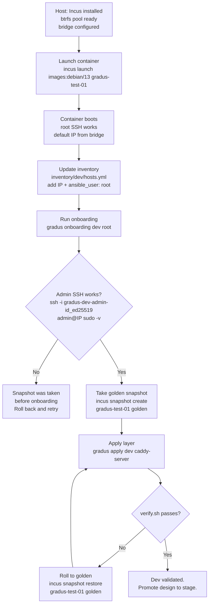

# Incus Dev Environment Design

Version 0.1.0 (2026-11-07). Companion to `ansible-dev-design-v0.1.3.md`.

## Purpose

Incus provides a local, fast, disposable environment for exercising the Ansible playbooks before they touch real infrastructure. Containers boot in under a second on btrfs, snapshots capture known-good states for rollback, and the same `onboarding.yml` runs against a container as against a VPS. If it passes here, it passes there.

## Requirements

| Component    | Minimum                 | Why                                    |
| ------------ | ----------------------- | -------------------------------------- |
| Incus        | 7.0.0+                  | LTS, stable API                        |
| Storage pool | btrfs                   | COW = instant snapshots, fast clones   |
| Network      | Incus-managed bridge    | Predictable IPs, no DHCP conflicts     |
| Image        | Debian 13 (trixie)      | Matches production target              |
| RAM          | 2 GB free per container | Ansible + Caddy + sshd fit comfortably |

## Incus lifecycle flowchart



## Storage: btrfs pool

The btrfs pool is what makes Incus feel like a VM host without the overhead. Snapshots are COW — they consume zero space until the child diverges from the parent. A full onboarding run (Python install, apt upgrade, 11 roles) creates thousands of file writes, but rolling back to golden takes milliseconds because we're just flipping a pointer.

### Pool setup (one-time, on the dev host)

```sh
# Create a btrfs pool from a dedicated partition or loopback
incus storage create gradus-pool btrfs source=/dev/sdb1

# Or for testing, a file-backed loop (slower but zero-config):
truncate -s 50G ~/incus-btrfs.img
sudo losetup -fP ~/incus-btrfs.img
sudo mkfs.btrfs /dev/loop0
incus storage create gradus-pool btrfs source=/dev/loop0

# Set as default pool for new instances
incus profile device add default root disk pool=gradus-pool path=/
```

### Why not ZFS or ext4

| Pool      | Snapshot speed | Clone speed       | Space reclaim       | Complexity             |
| --------- | -------------- | ----------------- | ------------------- | ---------------------- |
| **btrfs** | Instant (COW)  | Instant (reflink) | Automatic (balance) | Low                    |
| ZFS       | Instant (COW)  | Instant (clone)   | Immediate (destroy) | Medium (kernel module) |
| ext4      | N/A            | N/A               | N/A                 | Low, but no snapshots  |

btrfs is in the kernel, works out of the box on Debian 13, and gives us the COW semantics we need. ZFS would work too but adds a dependency.

## Network: the Incus bridge

Incus creates a default bridge (`incusbr0`) at `10.10.10.0/24` with DHCP. Containers get sequential IPs.

### Bridge configuration

```sh
# Check the default bridge
incus network show incusbr0

# If you need a custom range (to avoid conflicts with corporate LAN):
incus network create gradus-br0 \
 ipv4.address=10.20.30.1/24 \
 ipv4.nat=true \
 ipv6.address=fd42:10:20:30::1/64 \
 ipv6.nat=true

# Attach to a profile
incus profile device add gradus-dev eth0 network=gradus-br0 \
 ipv4.address=auto ipv6.address=auto
```

### IP allocation strategy

Static IPs are better than DHCP for dev containers because the inventory file doesn't change between launches.

```sh
# Launch with a specific IP
incus launch images:debian/13 gradus-test-01 \
 --profile default \
 --device eth0,ipv4.address=10.119.134.200
```

Option: Create a new profile

```bash
incus profile create gradus-dev
incus profile device add gradus-dev root disk pool=default path=/
```

Then you can run 

```bash
# Launch with a specific IP
incus launch images:debian/13 gradus-test-02 \
 --profile gradus-dev \
 --device eth0,ipv4.address=10.119.134.200
```

Then add to ansible inventory `inventory/dev/hosts.yml` is stable:

```yaml
# inventory/dev/hosts.yml
---
all:
 children:
  web:
   hosts:
    gradus-test-01:
      ansible_host: 10.20.30.10
      ansible_user: root
    gradus-test-02:
      ansible_host: 10.20.30.11
      ansible_user: root
   vars:
     environment: dev
```

## SSH Keypair Generation

```bash
# Generate dev keypairs (one-time, on the flow host)
ssh-keygen -t ed25519 -f ~/.ssh/gradus-dev-admin-id_ed25519 -C admin@laptop
ssh-keygen -t ed25519 -f ~/.ssh/gradus-dev-deploy-id_ed25519 -C deploy@ci -N ''

# Generate admin password hash for the dev vault
mkpasswd -m yescrypt
# Paste into vaults/dev.yml via ansible-vault edit
```

## Launching dev instances

### The launch script

```sh
#!/usr/bin/env bash
# test/incus/launch.sh — spin up a fresh dev container
set -euo pipefail

NAME="${1:?Usage: launch.sh <name> [ip]}"
IP="${2:-10.20.30.10}"
PROFILE="gradus-dev"
IMAGE="images:debian/13"

echo "Launching NAME at IP..."
incus launch "IMAGE" "NAME" \
 --profile "$PROFILE" \
 --device eth0=ipv4.address="$IP"

echo "Waiting for SSH..."
for i in $(seq 1 30); do
 if ssh-keyscan -T 2 "$IP" >/dev/null 2>&1; then
 echo "SSH ready at $IP"
 break
 fi
 sleep 1
done

echo "Taking pre-onboarding snapshot..."
incus snapshot create "$NAME" raw-state

echo "Done. Run: gradus onboarding dev root"
```

### Profiles

```sh
# gradus-dev profile: network + storage
incus profile create gradus-dev
incus profile device add gradus-dev eth0 network=gradus-br0 \
 ipv4.address=auto
incus profile device add gradus-dev root disk pool=gradus-pool path=/
```

## Snapshot strategy

Snapshots are the reason we test here instead of on real VPSes. They're free (COW), instant, and let us iterate without re-launching.

### Lifecycle

| Moment                    | Snapshot name  | Purpose                                                      |
| ------------------------- | -------------- | ------------------------------------------------------------ |
| Fresh boot                | `raw-state`    | Pre-onboarding. Roll back if onboarding bricks SSH.          |
| After onboarding passes   | `golden`       | Known-good normalized node. Roll back to test layer changes. |
| After caddy-server passes | `deploy-ready` | Full stack works. Roll back to test deploy scenarios.        |

### Commands

```sh
# Create
incus snapshot create gradus-test-01 golden

# List
incus snapshot list gradus-test-01

# Restore (container must be stopped)
incus stop gradus-test-01
incus snapshot restore gradus-test-01 golden
incus start gradus-test-01

# Clone from snapshot (fast parallel testing)
incus copy gradus-test-01/golden gradus-test-02
```

### The iterate-fast loop

```sh
# Change a task in onboarding.yml, then:
incus stop gradus-test-01
incus snapshot restore gradus-test-01 raw-state
incus start gradus-test-01
gradus onboarding dev root
# If it passes:
incus snapshot create gradus-test-01 golden
# If it fails: roll back, fix, retry. Zero cost.
```

## Connecting to Ansible

### Inventory update after launch

The `launch.sh` script outputs the IP. Either edit `inventory/dev/hosts.yml` manually or use a helper:

```sh
# gradus add-dev <name> <ip>
# Appends to inventory/dev/hosts.yml
```

### SSH key for root access

Incus containers boot with root password auth disabled and no keys. Two options:

**Option A: Console access (recommended for first boot)**

```sh
incus exec gradus-test-01 -- /bin/bash
# You're root. Set up what onboarding needs, or just verify the IP works.
```

**Option B: Pre-inject a key via profile**

```sh
# Create a cloud-init user-data file
cat > /tmp/user-data.yaml <<EOF
#cloud-config
users:
 - name: root
 ssh_authorized_keys:
 - $(cat ~/.ssh/gradus-dev-admin-id_ed25519.pub)
EOF

# Launch with user-data
incus launch images:debian/13 gradus-test-01 \
 --profile gradus-dev \
 --device eth0=ipv4.address=10.20.30.10 \
 --config cloud-init.user-data="$(cat /tmp/user-data.yaml)"
```

This mirrors what a VPS provider does with key injection. The container boots with root SSH ready for `onboarding.yml`.

## The verify script

`test/incus/verify.sh` already exists. It checks:

- Account existence (admin, deploy)
- SSH config (root refused, key-only, AllowUsers)
- Deploy key confinement (rrsync works, shell escape doesn't)
- Web service (Caddy responds, TLS valid)
- Port scan (only expected listeners open)

Run it against a dev container:

```sh
gradus verify dev
```

Or directly:

```sh
test/incus/verify.sh 10.20.30.10
```

## Troubleshooting

| Symptom                                 | Cause                                                  | Fix                                                       |
| --------------------------------------- | ------------------------------------------------------ | --------------------------------------------------------- |
| `Permission denied` on first SSH        | Container has no key injected                          | Use `incus exec` or relaunch with cloud-init              |
| `onboarding.yml` hangs at `update` role | Container waiting for reboot confirmation              | Set `update_reboot: false` in group_vars for dev          |
| `onboarding.yml` fails at `sshd -t`     | Typo in crypto drop-in                                 | Roll back to `raw-state`, fix template, retry             |
| `verify.sh` reports unexpected listener | fail2ban opened a port, or Caddy admin API on loopback | Check the audit script's loopback exclusion               |
| Container can't reach the internet      | Bridge NAT misconfigured                               | `incus network restart incusbr0` or check `ipv4.nat=true` |
| Snapshot restore fails                  | Container is running                                   | Stop first: `incus stop <name>`                           |

## Relationship to ansible-dev-design

| Document                       | Covers                                                       |
| ------------------------------ | ------------------------------------------------------------ |
| `ansible-dev-design-v0.1.3.md` | What the playbooks do, the interface contract, role selection |
| `incus-dev-design-v0.1.0.md`   | Where the playbooks run, how to iterate fast, snapshot lifecycle |
| `caddy-server.yml` (layer)     | What to apply AFTER onboarding passes on dev                 |

The dev loop is:

```
edit playbook → roll back to raw-state → run onboarding → verify → snapshot golden
edit layer → roll back to golden → apply layer → verify → snapshot deploy-ready
```

Each iteration takes seconds, not minutes. No cloud costs. No waiting for VPS provisioning.

## Open questions for this document

| Question                                                     | Status                                                       |
| ------------------------------------------------------------ | ------------------------------------------------------------ |
| Should `launch.sh` auto-update the inventory file?           | Probably yes, but keep it simple for v0.1.0                  |
| Multiple containers in parallel (matrix testing)?            | Nice future: test Debian 13, RHEL 9, Alpine in parallel      |
| Incus VMs for kernel-level testing (AppArmor, nftables hooks)? | Containers share the host kernel. VMs needed if we test kernel modules. |
| CI integration (run onboarding + verify in a pipeline)?      | Future. Local loop first.                                    |