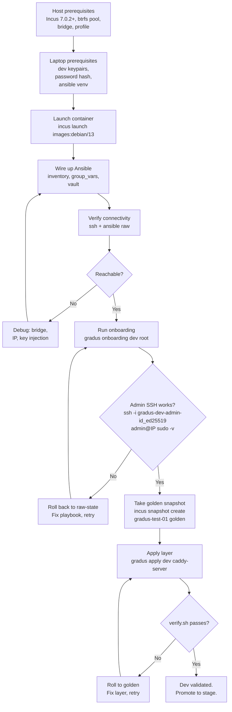

# Incus Dev Environment Design

Version 0.1.1 (2026-11-07). Companion to `ansible-dev-design-v0.1.3.md`.

## Purpose

Incus provides a local, fast, disposable environment for exercising the Ansible playbooks before they touch real infrastructure. Containers boot in under a second on btrfs, snapshots capture known-good states for rollback, and the same `onboarding.yml` runs against a container as against a VPS. If it passes here, it passes there.

## Workflow overview



## Host prerequisites (one-time)

These are configured once on the dev host (currently `flow`). If they're already done, skip to Laptop prerequisites.

| Component | Minimum | Why |
|---|---|---|
| Incus | 7.0.2 | macOS and Windows VM support (future cross-platform testing) |
| Storage pool | btrfs | COW = instant snapshots, fast clones |
| Network | Incus-managed bridge | Predictable IPs, no DHCP conflicts |
| Image | `images:debian/13` | Matches production target |
| RAM | 2 GB free per container | Ansible + Caddy + sshd fit comfortably |

#

## Btrfs pool

The btrfs pool is what makes Incus feel like a VM host without the overhead. Snapshots are COW — they consume zero space until the child diverges from the parent. A full onboarding run (Python install, apt upgrade, 11 roles) creates thousands of file writes, but rolling back to golden takes milliseconds because we're just flipping a pointer.

```sh
# Check existing pools
incus storage list

# If a btrfs pool doesn't exist yet, create one:
incus storage create gradus-pool btrfs source=/dev/sdb1

# Or for testing, a file-backed loop (slower but zero-config):
truncate -s 50G ~/incus-btrfs.img
sudo losetup -fP ~/incus-btrfs.img
sudo mkfs.btrfs /dev/loop0
incus storage create gradus-pool btrfs source=/dev/loop0
```

#

### Why not ZFS or ext4

| Pool | Snapshot speed | Clone speed | Space reclaim | Complexity |
|---|---|---|---|---|
| **btrfs** | Instant (COW) | Instant (reflink) | Automatic (balance) | Low |
| ZFS | Instant (COW) | Instant (clone) | Immediate (destroy) | Medium (kernel module) |
| ext4 | N/A | N/A | N/A | Low, but no snapshots |

btrfs is in the kernel, works out of the box on Debian 13, and gives us the COW semantics we need.

#

## Network bridge

Check what exists:

```sh
incus network list
```

The default bridge on `flow` is `10.119.134.0/24` with IPv6 at `fd42:48:ed9e:b152::/64`. If this matches your setup, no changes needed. If you need a custom range:

```sh
incus network create gradus-br0 \
 ipv4.address=10.119.134.1/24 \
 ipv4.nat=true \
 ipv6.address=fd42:48:ed9e:b152:1/64 \
 ipv6.nat=true
```

#

## Profile

A profile pins the container to the correct pool and bridge so you don't repeat flags on every launch.

```sh
# Check existing profiles
incus profile list

# Create gradus-dev if it doesn't exist
incus profile create gradus-dev
incus profile device add gradus-dev root disk pool=gradus-pool path=/
incus profile device add gradus-dev eth0 network=incusbr0 \
 ipv4.address=auto ipv6.address=auto
```

#

## Verify host prerequisites

```sh
incus info | grep -A2 "storage:"
incus network list
incus profile show gradus-dev
incus image list images:debian/13
```

All four commands should produce output. If any fail, fix before proceeding.

## Laptop prerequisites (one-time)

These are done on the laptop that runs Ansible. If the keypairs and vault already exist, skip to Launch a container.

#

## Generate dev keypairs

```sh
# Admin keypair (human access, sudo, console fallback)
ssh-keygen -t ed25519 -f ~/.ssh/gradus-dev-admin-id_ed25519 -C admin@laptop

# Deploy keypair (CI/rsync, confined to rrsync — no passphrase)
ssh-keygen -t ed25519 -f ~/.ssh/gradus-dev-deploy-id_ed25519 -C deploy@ci -N ''

# Verify they exist
cat ~/.ssh/gradus-dev-admin-id_ed25519.pub
cat ~/.ssh/gradus-dev-deploy-id_ed25519.pub
```

#

## Generate admin password hash

Used for sudo and the provider console only, never for SSH.

```sh
mkpasswd -m yescrypt
# Paste the output into vaults/dev.yml (next section)
```

#

## Activate the Ansible venv

```sh
source ~/.venvs/ansible/current/bin/activate
```

#

## Populate the vault

```sh
ansible-vault edit vaults/dev.yml
```

Inside the editor, paste:

```yaml
admin_password_hash: "yj9T$..."
```

Save and exit. The file is encrypted at rest; the vault password file (`vault-passwords/dev.pass`) is gitignored.

## Launch a container

#

## Quick launch

```sh
incus launch images:debian/13 gradus-test-01 \
 --profile gradus-dev \
 --device eth0,ipv4.address=10.119.134.200
```

Note the comma: `eth0,ipv4.address=...` — not `eth0=ipv4.address=...`.

#

## Using launch.sh

```sh
#!/usr/bin/env bash
# test/incus/launch.sh — spin up a fresh dev container
set -euo pipefail

NAME="${1:?Usage: launch.sh <name> [ip]}"
IP="${2:-10.119.134.200}"
PROFILE="gradus-dev"
IMAGE="images:debian/13"

echo "Launching NAME at IP..."
incus launch "IMAGE" "NAME" \
 --profile "$PROFILE" \
 --device "eth0,ipv4.address=$IP"

echo "Waiting for SSH..."
for i in $(seq 1 30); do
 if ssh-keyscan -T 2 "$IP" >/dev/null 2>&1; then
 echo "SSH ready at $IP"
 break
 fi
 if [ "$i" -eq 30 ]; then
 echo "ERROR: SSH not reachable after 30 seconds" >&2
 exit 1
 fi
 sleep 1
done

echo "Taking pre-onboarding snapshot..."
incus snapshot create "$NAME" raw-state

echo ""
echo "Done. Next steps:"
echo " 1. Wire up Ansible (inventory + group_vars + vault)"
echo " 2. Verify connectivity (see incus-dev-design doc)"
echo " 3. gradus onboarding dev root"
```

#

## Inject root SSH key

Incus containers boot with no SSH keys and no root password. Choose one method:

**Option A: Console injection (simplest)**

```sh
incus exec gradus-test-01 -- bash -c '
 mkdir -p /root/.ssh && chmod 700 /root/.ssh
 echo "'"$(cat ~/.ssh/gradus-dev-admin-id_ed25519.pub)"'" >> /root/.ssh/authorized_keys
 chmod 600 /root/.ssh/authorized_keys
 sed -i "s/#PermitRootLogin prohibit-password/PermitRootLogin yes/" /etc/ssh/sshd_config
 systemctl restart ssh
'
```

**Option B: Cloud-init at launch (mirrors VPS provisioning)**

```sh
incus launch images:debian/13 gradus-test-01 \
 --profile gradus-dev \
 --device eth0,ipv4.address=10.119.134.200 \
 --config cloud-init.user-data="$(cat <<EOF
#cloud-config
users:
 - name: root
 ssh_authorized_keys:
 - $(cat ~/.ssh/gradus-dev-admin-id_ed25519.pub)
ssh_pwauth: false
EOF
)"
```

Option B is closer to what a real VPS provider does. Use it when testing the cloud-init path. Option A is faster for quick iterations.

## Wire up Ansible

#

## Inventory

Add the container to `inventory/dev/hosts.yml`:

```yaml
---
all:
 children:
 web:
 hosts:
 gradus-test-01:
 ansible_host: 10.119.134.200
 ansible_user: root
 vars:
 environment: dev
```

#

## Group vars

Add the dev public keys to `inventory/dev/group_vars/all.yml`:

```yaml
admin_pubkey: "ssh-ed25519 AAAA... admin@laptop"
deploy_pubkey: "ssh-ed25519 AAAA... deploy@ci"
```

Copy from the files generated in the Laptop prerequisites section:

```sh
cat ~/.ssh/gradus-dev-admin-id_ed25519.pub
cat ~/.ssh/gradus-dev-deploy-id_ed25519.pub
```

#

## Vault

Confirm the password hash is in place (should be done from Laptop prerequisites):

```sh
ansible-vault view vaults/dev.yml --vault-password-file vault-passwords/dev.pass
```

#

## Verify Connectivity

Before running `onboarding.yml`, confirm Ansible can reach the container. onboarding.yml permanently locks root out of SSH — if the connection is wrong, you'll need the console to recover.

```sh
# 1. Container is alive and has the expected IP
incus exec gradus-test-01 -- hostname -I

# 2. SSH works as root with the admin key
ssh -i ~/.ssh/gradus-dev-admin-id_ed25519 root@10.119.134.200 "id && uname -a"

# 3. Ansible can reach it (raw module — does NOT require Python)
# Note: ansible ping WILL fail here because it needs Python, which
# onboarding.yml installs. Use raw instead.
ansible -i inventory/dev gradus-test-01 -m raw -a "echo ok" -u root
```

Expected output from step 3:

```json
{
 "changed": false,
 "rc": 0,
 "stdout": "ok\n"
}
```

If any step fails, **do not proceed**. Debug before onboarding:

| Failure | Cause | Fix |
|---|---|---|
| `incus exec` hangs | Container not booted | `incus start gradus-test-01` |
| SSH permission denied | Key not in root's authorized_keys | Inject via console (Option A above) |
| SSH timeout | Wrong IP or bridge issue | `incus list`, check the bridge |
| Ansible raw fails | SSH works but Ansible config is wrong | Check `ansible.cfg`, verify the inventory parses |

Once all three pass, you're ready:

```sh
gradus onboarding dev root
```

## Run onboarding

```sh
gradus onboarding dev root
```

Or directly:

```sh
ansible-playbook -i inventory/dev onboarding.yml -u root -K \
 --vault-password-file vault-passwords/dev.pass
```

After completion, verify admin access before closing the session:

```sh
ssh -i ~/.ssh/gradus-dev-admin-id_ed25519 admin@10.119.134.200 sudo -v
```

If this fails, roll back:

```sh
incus stop gradus-test-01
incus snapshot restore gradus-test-01 raw-state
incus start gradus-test-01
# Fix the playbook, retry
```

## Snapshot golden

Once onboarding passes and admin SSH works:

```sh
incus snapshot create gradus-test-01 golden
```

This is the known-good normalized state. Every subsequent test (layer changes, deploy simulation) rolls back to this point rather than re-running onboarding.

## Apply layer

```sh
gradus apply dev caddy-server
```

## Verify

```sh
gradus verify dev
```

Or directly:

```sh
test/incus/verify.sh 10.119.134.200
```

The verify script checks:

- Account existence (admin, deploy)
- SSH config (root refused, key-only, AllowUsers)
- Deploy key confinement (rrsync works, shell escape doesn't)
- Web service (Caddy responds, TLS valid)
- Port scan (only expected listeners open)

## Snapshot strategy

#

## Lifecycle

| Moment | Snapshot name | Purpose |
|---|---|---|
| Fresh boot | `raw-state` | Pre-onboarding. Roll back if onboarding bricks SSH. |
| After onboarding passes | `golden` | Known-good normalized node. Roll back to test layer changes. |
| After caddy-server passes | `deploy-ready` | Full stack works. Roll back to test deploy scenarios. |

#

## Commands

```sh
# Create
incus snapshot create gradus-test-01 golden

# List
incus snapshot list gradus-test-01

# Restore (container must be stopped)
incus stop gradus-test-01
incus snapshot restore gradus-test-01 golden
incus start gradus-test-01

# Clone from snapshot (fast parallel testing)
incus copy gradus-test-01/golden gradus-test-02
```

#

## The iterate-fast loop

```sh
# Change a task in onboarding.yml, then:
incus stop gradus-test-01
incus snapshot restore gradus-test-01 raw-state
incus start gradus-test-01
gradus onboarding dev root
# If it passes:
incus snapshot create gradus-test-01 golden
# If it fails: roll back, fix, retry. Zero cost.
```

## Troubleshooting

| Symptom | Cause | Fix |
|---|---|---|
| `Permission denied` on first SSH | Container has no key injected | Use console injection (Option A) |
| `onboarding.yml` hangs at `update` role | Container waiting for reboot confirmation | Set `update_reboot: false` in group_vars for dev |
| `onboarding.yml` fails at `sshd -t` | Typo in crypto drop-in | Roll back to `raw-state`, fix, retry |
| `verify.sh` reports unexpected listener | fail2ban opened a port, or Caddy admin API on loopback | Check the audit script's loopback exclusion |
| Container can't reach the internet | Bridge NAT misconfigured | Check `ipv4.nat=true` on the bridge |
| Snapshot restore fails | Container is running | Stop first: `incus stop <name>` |
| Bad device override syntax | Used `=` instead of `,` | `--device eth0,ipv4.address=IP` (comma between device and key) |
| `ansible ping` fails before onboarding | Python not installed yet | Use `-m raw` instead of `-m ping` |

## Relationship to other documents

| Document | Covers |
|---|---|
| `ansible-dev-design-v0.1.3.md` | What the playbooks do, the interface contract, role selection |
| `incus-dev-design-v0.1.1.md` | Where the playbooks run, how to iterate fast, snapshot lifecycle |
| `caddy-server.yml` (layer) | What to apply AFTER onboarding passes on dev |

## Open questions

| Question | Status |
|---|---|
| Should `launch.sh` auto-update the inventory file? | Probably yes, but keep it simple for v0.1.x |
| Multiple containers in parallel (matrix testing)? | Nice future: test Debian 13, RHEL 9, Alpine in parallel |
| Incus VMs for kernel-level testing (AppArmor, nftables hooks)? | Containers share the host kernel. VMs needed if we test kernel modules. |
| CI integration (run onboarding + verify in a pipeline)? | Future. Local loop first. |
| Does `robertdebock.update` trigger a reboot on containers? | Test on first run. Likely need `update_reboot: false`. |
| Does `robertdebock.openssh` template preserve the `Include` line? | Check role source. Determines if crypto drop-in works. |