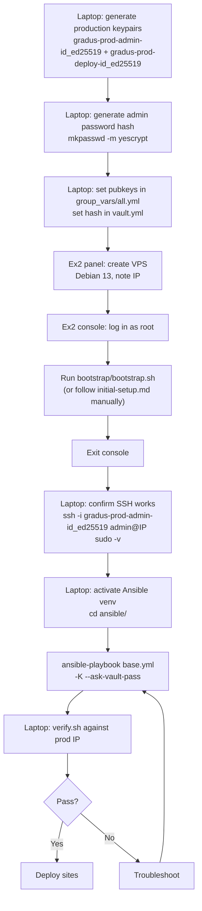

# process-flowchart-v0.4.0-production




## Entry routes compared

| Route | Console action | First Ansible play | Second play |
|---|---|---|---|
| cloud-init | (none — user-data does it) | `base.yml` as admin | — |
| `initial` user | create `initial`, inject its key | `bootstrap.yml` as `initial` | `base.yml` as admin |
| **`bootstrap.sh` (Ex2 path)** | run script as root | **`base.yml` as admin** | — |

`bootstrap.sh` creates `admin` and `deploy`, injects their keys, installs python3/sudo/rsync — everything `bootstrap.yml` does except the umask policy, which `base.yml` applies anyway. When you go console → `bootstrap.sh` → SSH, you jump straight to `base.yml`.

The `initial` user path exists for the manual runbook (`initial-setup.md`) where you want a throwaway user that `base.yml` deletes after creating the permanent ones. Cleaner forensics (nothing extra left behind), but unnecessary if you trust `bootstrap.sh`.

## Laptop preparation

### Generate production keypairs

Production keys are named distinctly from test keys so they never mix in `ssh-agent`.

```sh
ssh-keygen -t ed25519 -f ~/.ssh/gradus-prod-admin-id_ed25519 -C admin@laptop
ssh-keygen -t ed25519 -f ~/.ssh/gradus-prod-deploy-id_ed25519 -C deploy@ci -N ''
```

### Ansible setup

#### Generate the admin password hash

Used for sudo and the provider console only, never for SSH. Store in your password manager.

```sh
mkpasswd -m yescrypt
# paste output into ansible/group_vars/web/vault.yml (ansible-vault edit)
```

Ensure venv is enabled

```bash
. ~/.venvs/ansible/current/bin/activate
```

Add admin password hash to the `ansible/group_vars/web/vault.yml`

```bash
ansible-vault edit group_vars/web/vault.yml
```

paste in the pasword hash:

```bash
admin_password_hash: '$y$j9T$k.rs2L0nJjhJAmRNu5CtE0$CUGlgkyoMbSFNdxWQorRG6VTxhqHVm2hTOIKQ7YBtEC'
```

> **Placeholder hash.** The hash above was generated from the password `example` with `mkpasswd -m yescrypt`. It is not used on any server and is safe to publish, so secret scans can ignore it. Paste your own hash into the vault, never into the docs.

### Update group_vars/all.yml

grab your public key values:

```bash
cat ~/.ssh/gradus-prod-admin-id_ed25519.pub
```

```bash
ssh-ed25519 AAAAC3NzaC1lZDI1NTE5AAAAIG8SAPdqr+DK1NZ/iP/JDRVl2kBZ5UoUjvAtSBac4qSZ admin@laptop
```

```bash
cat ~/.ssh/gradus-prod-deploy-id_ed25519.pub
```

```bash
ssh-ed25519 AAAAC3NzaC1lZDI1NTE5AAAAIC0706vZ9wovUj2+HEPf0x9Cnqaga27BNdnoV/UCX9V9 deploy@ci
```

Edit `group_vars/all.yml`

```bash
nano group_vars/all.yml
```

Paste in the corresponding public keys:

```yaml
admin_pubkey: "ssh-ed25519 AAAAC3NzaC1lZDI1NTE5AAAAIG8SAPdqr+DK1NZ/iP/JDRVl2kBZ5UoUjvAtSBac4qSZ admin@laptop"
deploy_pubkey: "ssh-ed25519 AAAAC3NzaC1lZDI1NTE5AAAAIC0706vZ9wovUj2+HEPf0x9Cnqaga27BNdnoV/UCX9V9 deploy@ci"
admin_ssh_key: ~/.ssh/gradus-prod-admin-id_ed25519
```

Leave `initial_ssh_key` pointing at a valid key (even a throwaway one) so the assert in `bootstrap.yml` doesn't block accidental reruns, or remove the assert if you commit to the `bootstrap.sh` path permanently.

### 4. Update bootstrap.sh

Replace the hardcoded pubkey in `bootstrap.sh` with the contents of `~/.ssh/gradus-prod-admin-id_ed25519.pub`. The script injects it into `/home/admin/.ssh/authorized_keys`.

## Naming convention

| Purpose | Test (Incus) | Production |
|---|---|---|
| Admin (human, sudo, console fallback) | `~/.ssh/gradus-dev-admin-id_ed25519` | `~/.ssh/gradus-prod-admin-id_ed25519` |
| Deploy (CI/rsync, confined to rrsync) | `~/.ssh/gradus-dev-deploy-id_ed25519` | `~/.ssh/gradus-prod-deploy-id_ed25519` |

The `gradus-prod-` prefix makes it obvious which key is which in `ssh-agent`, prevents accidentally deploying to prod with a test key, and scales if you add a staging environment later.

## Firewall note

UFW is stable and maintained on Debian 13 (v0.36.2-9, nftables front-end). UC-Gradus uses raw nftables instead because:

- sshguard writes nftables sets directly; UFW's abstraction fights that integration
- The ruleset surgically replaces only its own table (`inet UCGradus`) so a reload doesn't wipe sshguard's dynamic blocks
- `audit-listeners.sh` checks for that specific table and its chains
- Robert de Bock's firewall role targets UFW/iptables/firewalld — evaluated and skipped

No change needed. Raw nftables is the correct choice for this stack.
