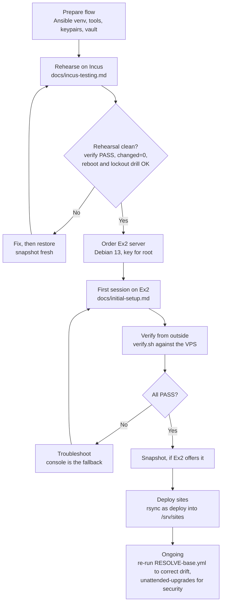
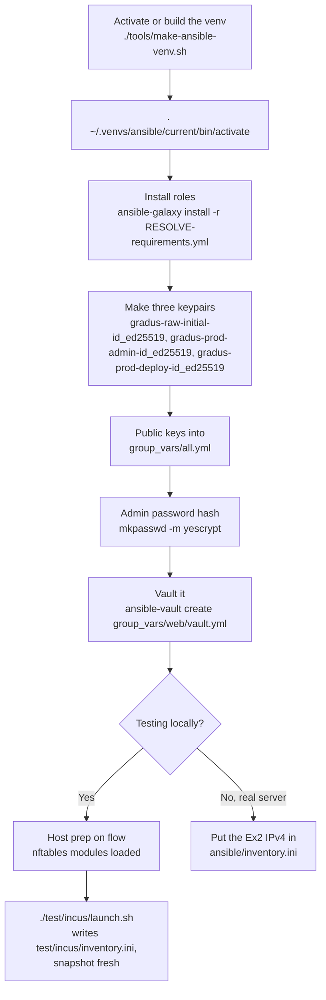
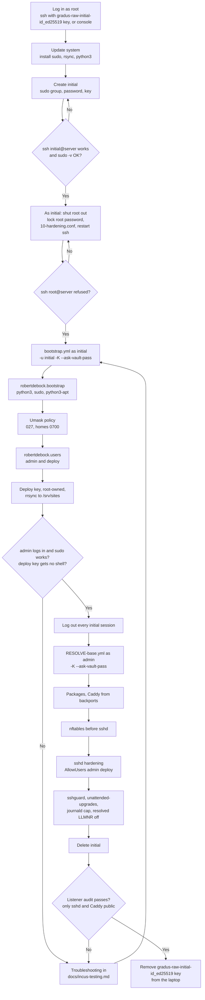
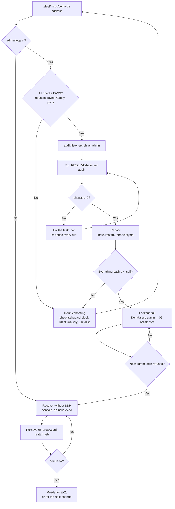
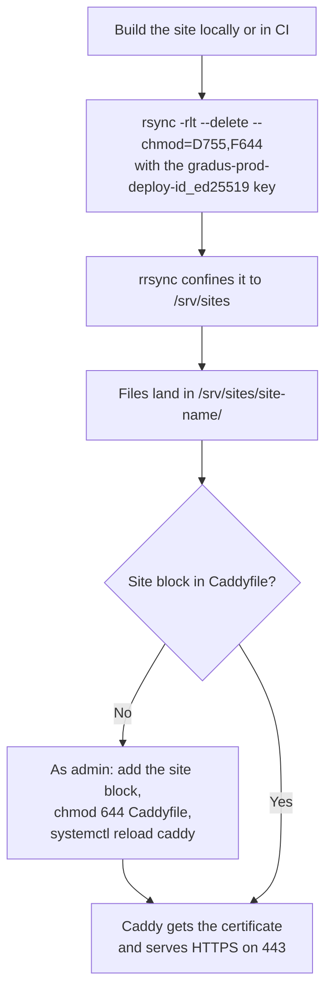

# Process flowcharts

These charts show how the pieces of ex2-base fit together, from preparing the laptop to deploying a site. Each box names the document or script that covers the step: `docs/ansible-venv.md`, `docs/initial-setup.md`, `docs/incus-testing.md` and the scripts in `test/incus/`. The charts use Mermaid, which GitHub and most Markdown viewers render as diagrams.

## Overview

The same procedure runs twice: first against a local Incus stand-in on flow, then against the real Ex2 server. Only the inventory differs.

## Preparing flow

Done once, and again when the Ansible pin or the keys change.

## First session

The same steps on the Incus stand-in and on Ex2. On Incus, the console is `incus exec` or `incus console`, and every playbook command adds `-i ../test/incus/inventory.ini`.

## Verify and recovery

After the first session, and again after any change to the playbooks.

## Deploying a site

Once the server is in place, every publish is one rsync as `deploy`.

